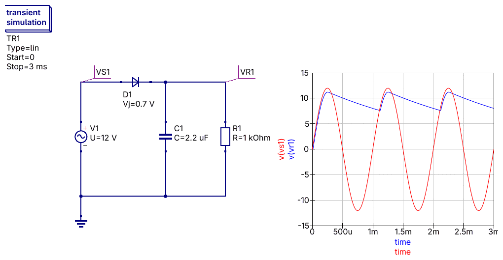
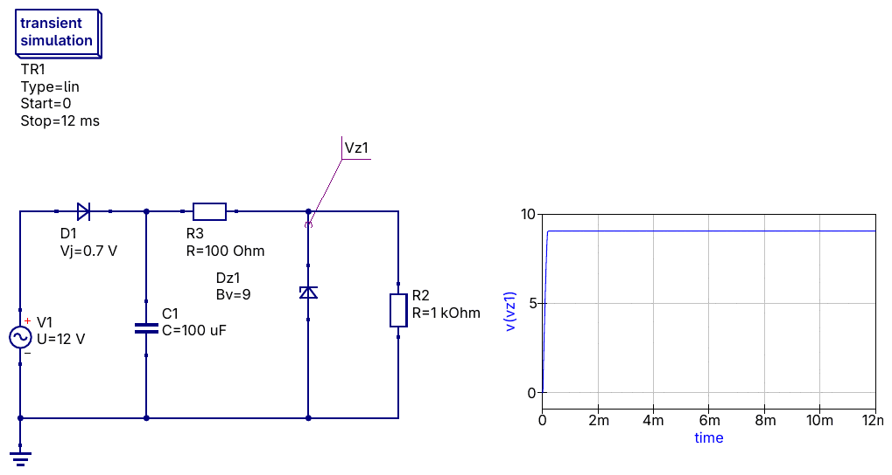
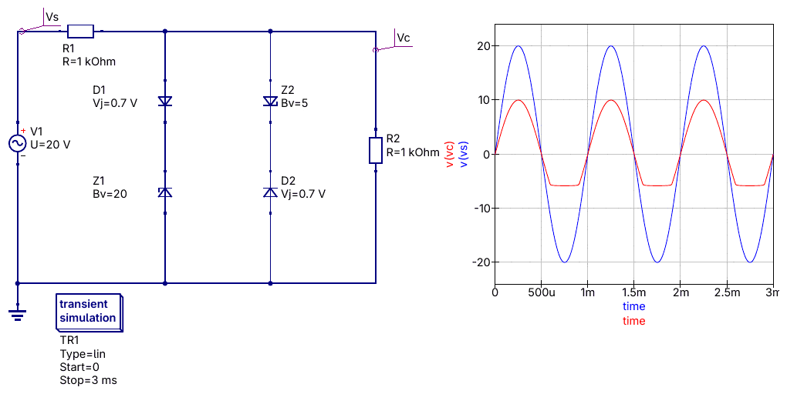

# C4T1 · Diodos

## Diodo

- [C1 de 2,2 µF](Diodo/Diodo.sch)

## Regulador Zener

- [Salida cercana a 9 V con R3 de 100 Ω](Regulador-9V/Zener-regulador.sch)
- [R3 de 1 kΩ](Regulador-R3-1k/Zener-regulador.sch)

## Recortador Zener

- [Z1 a 20 V](Recortador-Z1-20V/Zener-recortador.sch)
- [Z1 y Z2 a 20 V](Recortador-Z1-Z2-20V/Zener-recortador.sch)

